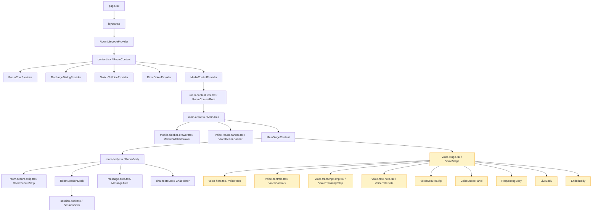
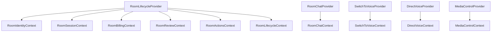

# Consultation Feature Architecture

## Component Tree (Client App)



## Provider Hierarchy



## Context Ownership Map

| Context | Owner Provider | Key Exports (Methods/State) |
|---------|---------------|----------------------------|
| **RoomIdentityContext** | RoomLifecycleProvider | `user`, `balance`, `expertData`, `roomConsultationId`, `router` |
| **RoomSessionContext** | RoomLifecycleProvider | `sessions`, `sessionId`, `sessionStatus`, `roomMode`, `maxMinutes`, `elapsedTime`, `timeLeft`, `displayElapsedTime`, `displayTimeLeft`, `isSessionEnded`, `pendingExpiresAt`, `voiceLive`, `setVoiceLive`, `voiceConnecting` |
| **RoomBillingContext** | RoomLifecycleProvider | `chatRate`, `sessionSummary`, `isWarning` |
| **RoomReviewContext** | RoomLifecycleProvider | `reviewRating`, `setReviewRating`, `reviewComment`, `setReviewComment`, `reviewSubmitted`, `setReviewSubmitted` |
| **RoomActionsContext** | RoomLifecycleProvider | `showModal`, `setShowModal`, `handleEndChat`, `decision`, `consultationState`, `endedVerdict`, `pausedState`, `pauseLiveChat`, `resumeLiveChat`, `endLiveChat`, `liveMessages`, `sendLiveMessage`, `sendLiveTyping`, `remoteTyping`, `sessionRevision`, `resumeRevision` |
| **RoomLifecycleContext** | RoomLifecycleProvider | **Full union** of all above slices (convenience) |
| **RoomChatContext** | RoomChatProvider | `messages`, `sendMessage`, `sendAttachment`, `pendingAttachments`, `setPendingAttachments`, `optimisticMessages` |
| **SwitchToVoiceContext** | SwitchToVoiceProvider | `voice` (hook return), `voiceRate`, `displayVoiceRate`, `handleUpgrade` |
| **DirectVoiceContext** | DirectVoiceProvider | `directVoice` (hook return), `isDirectVoice`, `showVoiceStage`, `dockProps`, `openVoiceCancel` |
| **MediaControlContext** | MediaControlProvider | `mediaStream`, `localVideoRef`, `remoteVideoRef`, `toggleCamera`, `toggleMic`, `toggleSpeaker`, `switchCamera` |

## Data Flow: Chat → Voice Upgrade → Direct Voice

### Chat Mode (Initial)
```
RoomLifecycleProvider
  → useConsultation (chat socket)
  → RoomActionsContext: sendLiveMessage, sendLiveTyping, liveMessages
  → RoomSessionContext: sessionStatus="chat", voiceLive=true
RoomChatProvider
  → RoomChatContext: messages, sendMessage
```

### Switch-to-Voice Upgrade (Chat → Voice)
```
User clicks "Upgrade to voice"
  → SwitchToVoiceContext.handleUpgrade("voice")
  → useSwitchToVoice.startVoice()
  → Backend creates voice session
  → RoomLifecycleProvider: sessionRevision++ → refreshSessions()
  → DirectVoiceProvider: roomMode === "voice" → isDirectVoice = true
  → DirectVoiceProvider: useDirectVoice enabled
  → DirectVoiceContext: directVoice.active=true, phase="requesting"→"connecting"→"live"
  → DirectVoiceContext: showVoiceStage=true
  → MainArea: showVoiceStage → renders VoiceStage
```

### Direct Voice (Voice-First)
```
URL: /consultation/[id]?mode=voice
  → layout.tsx: initialSessions=[] → roomMode="voice"
  → DirectVoiceProvider: isDirectVoice=true immediately
  → useDirectVoice connects to Agora
  → DirectVoiceContext: showVoiceStage=true from start
  → VoiceStage renders immediately (no chat history)
```

## Current Prop Drilling Issues

### SessionDock (22 props, 12 are callbacks)

**Current `SessionDockProps`:**
```typescript
{
  // Data props (keep)
  kind: SessionKind;
  phase: SessionPhase;
  elapsedText: string;
  rate: number;
  muted: boolean;
  speakerMuted: boolean;
  cameraEnabled?: boolean;
  expanded?: boolean;
  className?: string;

  // Callback props (MOVE TO CONTEXT)
  onToggleMute: () => void;
  onToggleSpeaker: () => void;
  onToggleCamera?: () => void;
  onToggleExpand?: () => void;
  onEnd: () => void;
  onCancelRequest?: () => void;
  onSwitchToChat?: () => void;
  onUpgradeToVideo?: () => void;
  onSwitchToVoice?: () => void;
}
```

**Source of callbacks in `direct-voice.provider.tsx:116-146`:**
```typescript
dockProps: SessionDockProps | null = useMemo(() => {
  if (isDirectVoice) {
    return {
      kind: "voice",
      phase: directVoice.phase,
      elapsedText: formatTime(elapsedTime),
      rate: displayVoiceRate,
      muted: directVoice.muted,
      onToggleMute: () => void directVoice.toggleMic(),      // ← already in directVoice
      speakerMuted: directVoice.speakerMuted,
      onToggleSpeaker: () => void directVoice.toggleSpeaker(), // ← already in directVoice
      onEnd: openVoiceCancel,                                 // ← already in context
      onCancelRequest: openVoiceCancel,                       // ← duplicate
    };
  }
}, [...]);
```

### VoiceStage (25 props, 11 are callbacks)

**Current `VoiceStageProps`:**
```typescript
{
  // Data props (keep)
  phase: VoicePhase;
  expertName: string;
  expertAvatar?: string | null;
  elapsedText: string;
  chatRate: number;
  voiceRate: number;
  messages: ChatMessage[];
  entry?: "upgrade" | "direct";
  className?: string;

  // Callback props (MOVE TO CONTEXT)
  onBackToChat: () => void;
  onEndVoice: () => void;
  onCancelRequest: () => void;
  onExpandChat: () => void;
  onToggleMute: () => void;
  onToggleSpeaker: () => void;
}
```

**Source in `voice-stage.tsx:194-254`:**
```typescript
const props: VoiceStageProps = {
  phase,
  expertName: expertData?.name ?? "Expert",
  // ...
  onBackToChat: backToChat,        // ← from voice.backToChat or directVoice.switchToChat
  onEndVoice: endVoice,            // ← from openVoiceCancel or voice.cancelVoice
  onCancelRequest: cancelVoice,    // ← from directVoice.cancelVoice or voice.cancelVoice
  onExpandChat: backToChat,        // ← duplicate of onBackToChat
  muted,
  onToggleMute: toggleMute,        // ← from directVoice.toggleMic or voice.toggleMic
  speakerMuted,
  onToggleSpeaker: toggleSpeaker,  // ← from directVoice.toggleSpeaker or voice.toggleSpeaker
};
```

## Target Architecture After Consolidation

### SessionDock (8 props, 0 callbacks)
```typescript
{
  kind: SessionKind;
  phase: SessionPhase;
  elapsedText: string;
  rate: number;
  muted: boolean;
  speakerMuted: boolean;
  cameraEnabled?: boolean;
  expanded?: boolean;
  className?: string;
}
// Consumes internally:
const { toggleMic, toggleSpeaker, endVoice, cancelVoice, switchToChat, toggleExpand } = useDirectVoiceContext();
// Or for switch-to-voice mode:
const { voice } = useSwitchToVoiceContext(); // voice.toggleMic, voice.toggleSpeaker, voice.backToChat, voice.cancelVoice
const { pauseLiveChat, resumeLiveChat, endLiveChat } = useRoomActions();
```

### VoiceStage (14 props, 0 callbacks)
```typescript
{
  phase: VoicePhase;
  expertName: string;
  expertAvatar?: string | null;
  elapsedText: string;
  chatRate: number;
  voiceRate: number;
  messages: ChatMessage[];
  entry?: "upgrade" | "direct";
  className?: string;
}
// Consumes internally:
const { directVoice, isDirectVoice, openVoiceCancel } = useDirectVoiceContext();
const { voice } = useSwitchToVoiceContext();
const { endLiveChat } = useRoomActions();
```

## Context Extension Plan

### DirectVoiceContextValue (Add)
```typescript
export interface DirectVoiceContextValue {
  directVoice: ReturnType<typeof useDirectVoice>;
  isDirectVoice: boolean;
  showVoiceStage: boolean;
  dockProps: SessionDockProps | null; // DEPRECATE after SessionDock migration
  openVoiceCancel: () => void;
  
  // NEW: Direct method exposure
  toggleMic: () => void;
  toggleSpeaker: () => void;
  endVoice: () => void;
  cancelVoice: () => void;
  switchToChat: () => void;
  toggleExpand: () => void;
}
```

### SwitchToVoiceContextValue (Add)
```typescript
export interface SwitchToVoiceContextValue {
  voice: ReturnType<typeof useSwitchToVoice>;
  voiceRate: number;
  displayVoiceRate: number;
  handleUpgrade: (mode: "voice" | "video") => void;
  
  // NEW: Direct method exposure for VoiceStage/VoiceControls
  backToChat: () => void;
  cancelVoice: () => void;
  toggleMic: () => void;
  toggleSpeaker: () => void;
}
```

## Component-to-Context Mapping

| Component | Primary Context | Secondary Context |
|-----------|----------------|-------------------|
| `RoomContentRoot` | `RoomLifecycleContext` | - |
| `MainArea` | `RoomSessionContext`, `SwitchToVoiceContext`, `DirectVoiceContext` | - |
| `RoomBody` | `RoomSessionContext`, `DirectVoiceContext` | `RoomActionsContext` |
| `RoomSessionDock` | `DirectVoiceContext` | - |
| `SessionDock` | `DirectVoiceContext` (direct) / `SwitchToVoiceContext` (upgrade) | `RoomActionsContext` |
| `MessageArea` | `RoomChatContext` | `RoomSessionContext` |
| `ChatFooter` | `RoomChatContext` | `RoomActionsContext` |
| `VoiceStage` | `DirectVoiceContext` (direct) / `SwitchToVoiceContext` (upgrade) | `RoomActionsContext`, `RoomChatContext`, `RoomBillingContext`, `RoomIdentityContext` |
| `VoiceHero` | `DirectVoiceContext` / `SwitchToVoiceContext` | `RoomIdentityContext` |
| `VoiceControls` | `DirectVoiceContext` / `SwitchToVoiceContext` | - |
| `VoiceTranscriptStrip` | `RoomChatContext` | `DirectVoiceContext` / `SwitchToVoiceContext` |
| `VoiceRateNote` | `RoomBillingContext` | `SwitchToVoiceContext` |

## Migration Checklist

### Phase 2: Context Consolidation
- [ ] Extend `DirectVoiceContextValue` with direct methods
- [ ] Extend `SwitchToVoiceContextValue` with direct methods  
- [ ] Update `DirectVoiceProvider` to provide new methods
- [ ] Update `SwitchToVoiceProvider` to provide new methods
- [ ] Remove `dockProps` construction from `DirectVoiceProvider`

### Phase 3: Prop Simplification
- [ ] Simplify `SessionDockProps` interface
- [ ] Update `SessionDock` to consume from context
- [ ] Simplify `VoiceStageProps` interface
- [ ] Update `VoiceStage` to consume from context
- [ ] Update `VoiceControls` to consume from context (likely already does)
- [ ] Update `VoiceHero` to consume from context
- [ ] Update `VoiceTranscriptStrip` to consume from context

### Phase 4: Documentation
- [ ] Add `@see` JSDoc tags on components linking to context hooks
- [ ] Update this ARCHITECTURE.md with post-migration state

### Phase 5: Validation
- [ ] TypeScript check
- [ ] ESLint check
- [ ] Existing tests pass
- [ ] Manual flow: chat → upgrade → direct voice → end session